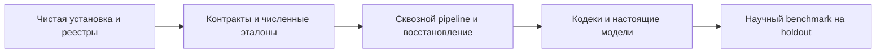

# Схема тестирования DWARF

Срез: 17 ноября 2026 года, `main` / `origin/main`,
`f9d6cb14c668ab45c968a8d2c25b6160c1d050b4`.
Документ задаёт план развития тестов и научных экспериментов, а также отмечает
реализованный базовый набор. К тестам решений добавлены проверки конфигураций,
публичного CLI и процессного pipeline в `tests/pipeline_core/`.

## Границы проверки

По прямому указанию пользователя из нового тестового плана исключены:

- `dwarf/ready_solutions/embedding_solutions/frequency/contourlet.pyx`;
- `dwarf/ready_solutions/embedding_solutions/frequency/dct.pyx`;
- `dwarf/ready_solutions/embedding_solutions/frequency/dft.pyx`;
- `dwarf/ready_solutions/embedding_solutions/frequency/dwt.pyx`.

Для них не добавляем и не меняем тесты; существующие DCT-тесты не включены
в приведённый ниже проверочный прогон. Общая сборка пакета компилирует эти
расширения штатным `setup.py`, не изменяя их исходники.

Оставшаяся область: `ADC_ABW`, отдельный Python-модуль `Contourlet_Wu2023`,
32 атаки, 20 метрик, реестры и процессный `dwarf/pipeline_core`.
`Contourlet_Wu2023` находится в `frequency/contourlet_wu2023.py` и не является
исключённым `contourlet.pyx`. В реестре всего шесть конкретных embedding-решений;
четыре исключённых метода сохраняют статус «вне согласованной области».

## Основания и смысл стандартов

[ISO/IEC 25010:2023](https://www.iso.org/standard/78176.html) задаёт модель
качества продукта. [ISO/IEC/IEEE 29119-2:2021](https://www.iso.org/standard/79428.html)
описывает процессы тестирования; в [серии 29119](https://committee.iso.org/sites/jtc1sc7/home/projects/flagship-standards/isoiecieee-29119-series.html)
часть 3 отвечает за тестовую документацию, часть 4 за техники проектирования тестов.
Используем эти направления для организации работы. Сопоставление ниже является
проектным предложением; проверка по открытым описаниям не устанавливает
формального соответствия всем требованиям полных текстов стандартов.

Для научной части полезны профили испытаний и независимые атаки
[StirMark](https://www.petitcolas.net/watermarking/stirmark/index.html), а также
совместная оценка качества изображения и обнаружения ЦВЗ в
[WAVES](https://arxiv.org/abs/2401.08573). Эти работы дают методические ориентиры.
Их протоколы не становятся выполненными от одного упоминания в DWARF.
Числа, сетки и пороги ниже предложены для проекта и не предписаны ISO.

| Направление качества | Проверка в DWARF | Доказательство |
| --- | --- | --- |
| Функциональная пригодность | Контракты, формулы, корректные цепочки, полнота реестров | Ожидаемые значения и интеграционные результаты |
| Эффективность | Время стадий, RAM, shared memory, пропускная способность | Замеры на фиксированном оборудовании |
| Совместимость | NumPy/Pillow, кодеки, wheel, совместимость параметров | Чистая установка и эталонные вызовы |
| Взаимодействие с пользователем | YAML-ошибки с путём поля, понятный отчёт, документированные команды | Негативные сценарии конфигурации |
| Надёжность | Сбой worker/кодека/SQLite, повторный запуск, ограниченные ожидания | Записи `failed`, восстановление, отсутствие утечек |
| Защищённость | Безопасный YAML, доверенные plugins, границы файлов, лимиты ресурсов | Негативные тесты загрузки и записи |
| Сопровождаемость | Ruff, локальные правила codestyle, независимые численные эталоны | CI и обзор изменений; явные исключения правил |
| Гибкость | Windows/Linux, поддерживаемые Python, optional-пакеты | Матрица сред с указанием доступных возможностей |
| Безопасность эксплуатации | Сохранность входов/результатов, управляемый overwrite | Проверки немодификации, транзакций и очистки |

Для требований вводим идентификаторы `REG`, `EMB`, `ATK`, `MET`, `PIPE`, `REP`.
Каждое требование связываем с тестом, входным набором, ожидаемым результатом
и артефактом прогона. В плане отмечаем риск и приоритет; в итоговом протоколе
разделяем `passed`, `failed`, `skipped`, `xfail` и исключения области.

## Уровни и условия запуска



| Уровень | Содержание | Когда запускать | Условие принятия |
| --- | --- | --- | --- |
| L0: установка и статические проверки | Чистая сборка расширений, импорты, реестры, Ruff/codestyle | Каждый PR с кодом или зависимостями | Нет ошибок; исключения перечислены |
| L1: контракты и численные эталоны | Синтетические матрицы, граничные входы, независимые формулы | Каждый PR затронутой области | Все обязательные проверки проходят |
| L2: сквозной pipeline | YAML → dataset → worker → метрики → SQLite; `spawn`, resume, ошибки | Каждый PR pipeline; перед выпуском | Точное число и содержимое случаев, нет зависания/потерь |
| L3: расширенная среда | Внешние кодеки, настоящие pyiqa-модели, несколько ОС | По расписанию и перед выпуском | Все заявленные возможности проверены в подготовленной среде |
| L4: научный benchmark | Закрытый holdout, сетки атак, несколько ключей, статистика и профили статей | При изменении метода или научных выводов | Полный протокол, интервалы неопределённости, указанные ограничения |

В L0–L2 отсутствие обязательной зависимости является ошибкой подготовки среды.
В обычном PR допустим только заранее перечисленный capability skip optional-модуля.
В L3 нужные возможности проверяем до pytest: отсутствие заявленного кодека или
модели завершает подготовку ошибкой, а не создаёт зелёный отчёт с пропусками.
`RuntimeError` доступного компонента не превращаем в `skip`.
Для `xfail(strict=True)` записываем конкретный дефект и условие его снятия.

## Матрица решений

### REG и EMB: реестры и встраивание

| Объект | Что уже есть | Что добавить в согласованной области |
| --- | --- | --- |
| Реестры | Точное множество атак и метрик, категории и доступность по имени | Проверку регистрации `ADC_ABW`/`Contourlet_Wu2023`, отсутствия удалённых методов и явного списка четырёх исключений; исключённые методы не вызывать |
| `ADC_ABW` | `tests/embeddings/test_adc_abw.py`: формулы ADC/ABW, геометрия блоков, параметры, round-trip, JPEG surrogate | Стратифицированные payload/ключи/изображения; сохранение PNG → загрузка → extraction; согласованность прямого вызова и pipeline |
| `Contourlet_Wu2023` | `tests/embeddings/test_contourlet_wu2023.py`: внутренние формулы, нормализация, условный аудит авторских изображений | Обычный публичный embedding → extraction без внешних assets; контракты, немодификация, детерминизм, ошибки параметров и ёмкости |

Оба разрешённых метода принимают RGB `uint8` `(H,W,3)` и одномерные бинарные
`uint8`-биты. Проверяем непрерывный выход RGB `uint8`, извлечённые `int8`-биты
нужной длины и неизменность входов. Проверки ошибок включают пустой payload,
небинарные значения, выход за ёмкость, неверный dtype/shape и параметры вне области.
Strided/read-only массив либо обрабатывается корректно, либо получает
документированную ошибку; тест не должен заранее выдумывать общий контракт.

Для `ADC_ABW` отдельно учитываем `num_blocks`, длину spreading-кода и предел
payload в реализации: не больше `min(spreading_length, 64)` бит. Проверяем
неполные края изображения, энергию выбранных коэффициентов, совпадение ключа
при извлечении и явное поведение при неверном ключе. Отсутствие геометрической
синхронизации фиксируем как свойство метода.

Для `Contourlet_Wu2023` проверяем геометрию ROI, ёмкость QIM-блоков, параметры
Arnold, режимы нормализации и вырожденные изображения. Профиль статьи с
калиброванными параметрами держим отдельно от defaults. Совпадение средней PSNR
после подбора параметров не доказывает точного воспроизведения авторского опыта.

### ATK: все 32 атаки

| Семейство и точные имена | Эталон / инвариант | Особые условия |
| --- | --- | --- |
| Шум (6): `AWGN`, `Impulse`, `Periodic`, `Poisson`, `Salt_and_Pepper`, `Speckle` | Среднее/дисперсия или доля изменённых пикселей на достаточно большом наборе; одинаковый seed воспроизводим | Разные независимые seed, проверка шкалы [0,255] и насыщения |
| Цвет (9): `Bit_Depth_Reduction`, `Brightness_Contrast`, `Color_Jitter`, `Color_Quantization`, `Color_Space_Noise`, `Dithering`, `Gamma_Correction`, `Grayscale`, `Histogram_Equalization` | LUT/формулы, число уровней, равенство каналов grayscale, независимый эталон CLAHE | Вырожденные гистограммы, диапазоны параметров, случайные режимы |
| Фильтрация (8): `Anisotropic_Diffusion`, `Bilateral_Filter`, `Box_Filter`, `Gaussian_Blur`, `Homomorphic_Filter`, `Median_Filter`, `Unsharp_Mask`, `Wiener_Filter` | Импульс, константа, границы; независимая свёртка/реализация при одинаковых padding и округлении | `Bilateral_Filter` требует OpenCV; усиление резкости не обязано уменьшать ошибку |
| Сжатие (8): `Avif`, `Bpg`, `Flif`, `Heic`, `Jpeg`, `Jpeg2000`, `Tiff`, `Webp` | Успешный encode/decode, dtype/range, независимый декодер; точное равенство только для настроенного lossless-режима | Версии/наличие кодеков; повреждённый вывод, stderr, ненулевой exit, timeout внешнего процесса |
| Геометрия (1): `Crop` | Координатный эталон области, документированные resize/padding | Прямоугольники, края, пропорции; форма результата зависит от режима |

База уже находится в `tests/attacks/`: contract, registry и тематические тесты.
Дополняем её только найденными пробелами. Для всех атак проверяем немодификацию
входа, отсутствие неожиданного aliasing, допустимые размеры и параметры.
Порядок цепочки сохраняем: JPEG → crop и crop → JPEG являются разными случаями.
Монотонность искажения проверяем лишь там, где её гарантирует формула;
малая случайная выборка и шкала quality кодека такой гарантии не дают.

### MET: все 20 метрик

| Группа | Имена | Численная проверка |
| --- | --- | --- |
| Пиксельное качество | `MSE`, `PSNR`, `SSIM`, `MS_SSIM` | Ручные малые примеры, NumPy, scikit-image/sewar при одинаковых data range, окнах и каналах |
| Признаки / восприятие | `FSIM`, `FSIMc`, `VIF` | Независимый эталон и фиксированные регрессии с записанным происхождением |
| Модели | `LPIPS`, `DISTS`, `NIQE`, `BRISQUE` | Отдельно адаптер с подменённым backend и настоящая модель с зафиксированными весами/preprocessing |
| Биты | `BER`, `NC` | Равные, инвертированные, частично ошибочные, пустые и несовпадающие по длине последовательности; нулевой знаменатель NC |
| Изображение ЦВЗ | `Watermark_PSNR` | Согласованная шкала и размер; одинаковые и искажённые watermarks |
| Детектор | `Accuracy`, `Precision`, `Recall`, `F1`, `AUC`, `P_Value` | Ручная confusion matrix и sklearn; ties, один класс, деление на ноль; p-value по заданному null-распределению |

Существующее покрытие находится в `tests/expertise/`; полноту каждого свойства
нужно учитывать по отдельной метрике. В расширяемом наборе проверим правильные
имена входов, немодификацию, форму/длину, NaN/Inf на входе и семантический
диапазон результата. Универсальной проверки NaN/Inf для всех метрик пока нет.
Допуск для простых float64-формул предлагаем начать с `rtol=1e-6, atol=1e-8`;
для каждого независимого backend его обосновываем отдельно. Биты и lossless
сравниваем точно. Не расширяем допуск только ради прохождения теста.

`PSNR=+inf` при нулевой MSE математически допустима. Экспорт должен задавать
её явно, например `value: null, value_kind: "positive_infinity"`; голые
`Infinity`/`NaN` не являются строгим JSON. `NC` не подменяет BER, а порог
детекции не выводится из универсального значения NC без null-эксперимента.

## PIPE: обязательные сквозные сценарии

Ниже целевая матрица pipeline. Базовая группа `tests/pipeline_core/` уже создана:
`test_config.py` проверяет загрузку YAML, схему и все YAML-примеры;
`test_case_builder.py` — fixed/grid/variants, число случаев, порядок цепочек и seed;
`test_cli_pipeline.py` — CLI, реальные процессы с ADC_ABW, результаты и resume.
Интеграции не вызывают четыре исключённых embedding-метода.

| ID | Сценарий | Ожидаемый результат |
| --- | --- | --- |
| PIPE-01 | YAML: неизвестные/повторные поля, неверные типы, unsafe tags, относительные пути | Предсказуемая ошибка до запуска процессов; пути относительно YAML |
| PIPE-02 | `fixed`/`grid`/`variants`, linked-параметры, пустая цепочка, repeats, max_cases | Число построенных случаев совпадает с аналитическим расчётом; перебор не теряет параметры |
| PIPE-03 | Два временных PNG, ADC_ABW, clean/JPEG, repeats=2, `spawn`, workers=1 | Ровно 8 `done` в SQLite, 2 processed images; ожидаемые метрики без stage-подмены |
| PIPE-04 | Повторный запуск `overwrite=False`, прерывание между dispatch и commit | Готовые записи неизменны, незавершённые восстанавливаются; нет дубликатов |
| PIPE-05 | workers=1/2, max_in_flight, разный порядок завершения | Одинаковые содержательные результаты и seed, ограниченные очереди/RAM, все процессы завершаются |
| PIPE-06 | Ошибка/смерть worker, отсутствующий файл/кодек, SQLite locked/disk error | Сохранённые `failed` и причина, работающий fail_fast, конечный timeout; нет тихой потери результатов |
| PIPE-07 | Ошибки до открытия shared memory и после него; нормальный выход | Нет утечек сегментов/handles; cleanup не маскирует исходную ошибку |
| PIPE-08 | Checkpoints и bindings всех классов метрик; clean PSNR=inf | Верные original/embedded/attacked/extracted; строгий JSON; результат нельзя признать полным при потерянной метрике |
| PIPE-09 | Manifest, shuffle, recursive, изменение байтов файла при прежнем имени | Стабильный порядок; фильтры соблюдены; содержимое датасета участвует в идентичности опыта |
| PIPE-10 | Параметры конфигурации serial/process, exports, save_images, report | Каждый обещанный режим выполняется либо явно отклоняется; принятие поля моделью не считается реализацией |

Текущие тесты покрывают базовые сценарии PIPE-01–04, запуск с workers=1/2 и
запись runtime-ошибок. Они не доказывают восстановление после аварийного
прерывания, обработку отказов SQLite, fail_fast, отсутствие всех утечек или
работоспособность reports/exports. Для проверок метрик в сквозном наборе
используются конечные MSE/BER; известный случай сериализации PSNR=inf остаётся
отдельным открытым дефектом. `Parent` всегда создаёт процессный пул, поэтому
CLI отклоняет `backend: serial` при исполнении до запуска процессов.

При расчёте объёма: `N = images × Σ(embedding_variants × extraction_variants)
× Σscenario(Πstep attack_variants) × Πmetric metric_variants × repeats`.
Пустая clean-цепочка даёт один вариант. В изолированном тесте проверяем и
формулу, и реальные записи, чтобы тест не копировал ошибку `count_cases()`.

Приоритетные риски по чтению текущего кода: manifest не сортирует `rglob` и
не сохраняет SHA-256 файлов; image ID зависит от пути/preprocessing, а не
байтов. `run_id` не включает версию кода и содержимое датасета. Seed случая
вычисляется, но случайным атакам явно не передаётся. Нельзя пока утверждать
полную воспроизводимость атак или безопасное переиспользование старой БД
после изменения входных файлов. Это кандидаты для PIPE-05/09, не результаты
уже реализованных тестов.

## REP: протокол научного сравнения

Разделяем проверки реализации, соответствие уравнениям статьи и воспроизведение
авторского эксперимента. Для последних уже есть
`examples/pipeline/adc_abw4_reproduction_manifest.yaml` и
`examples/pipeline/wu2023_contourlet_reproduction_manifest.yaml`: они перечисляют
опубликованные параметры и недостающие сведения. Суррогатный COCO-опыт помечаем
как surrogate; средние числа из статьи не делаем универсальным критерием CI.

Подготовка данных: малые синтетические матрицы для L1; предлагаемые 100 разных
изображений для калибровки и отдельные 1000 для итоговой оценки L4. Стратифицируем
фотографии, текстуры, плоские области, текст/графику, размеры и пропорции.
Исключаем дубликаты между выборками. Храним список файлов, SHA-256, источник,
разрешение использования и preprocessing. Недостающий авторский материал
помечаем как ограничение воспроизведения, а не заменяем незаметно.

Для сравнения ADC_ABW и Contourlet_Wu2023 используем общую допустимую длину,
например 64 бита, одинаковые images/payloads/атаки и несколько независимых ключей.
Отдельно публикуем родные профили методов, где payload может отличаться.
Параметры качества подбираем только на калибровочной выборке; возможная цель
сравнения — PSNR в полосе 40±0.5 dB с обязательным указанием достижимости этой
полосы каждым методом. Это исследовательское условие, не стандарт качества.

ЦВЗ фиксируем для изображения (`per_image`) во всех сравниваемых ветвях.
Независимые RNG-потоки задаём для payload, ключа и атаки; один и тот же seed
атаки применяем при сравнении методов. Детерминированный повтор неизменного
опыта нужен для регрессии и не считается новым независимым наблюдением.

| Профиль атаки | Предлагаемая начальная сетка | Что записывать |
| --- | --- | --- |
| Clean и файловый round-trip | Без атаки; lossless PNG | BER=0 на допустимом контрольном наборе, качество встраивания, clipping |
| Сжатие | JPEG quality 95/90/75/50/30/10; остальные кодеки отдельными профилями | Encoder, subsampling, lossless-флаги, качество изображения; quality разных форматов не эквивалентны |
| Шум | AWGN σ=1/3/5/10 в шкале 0–255; salt/pepper доля .001/.01/.05 | RNG, фактическая мощность, доля замен; остальные шумы с собственной шкалой |
| Фильтры и цвет | Размеры ядра 3/5/7; gamma .8/1.2; уровни квантования | Все параметры, padding, clipping/rounding и направление gamma |
| Геометрия | Crop с сохранением .9/.75/.5 площади и заданными координатами | Политика восстановления размера/синхронизации; поворот/resize — только отдельным явным адаптером, пока таких атак нет в реестре |
| Составные цепочки | JPEG→crop и crop→JPEG; noise→JPEG | Порядок, промежуточные размеры, seed каждой стадии |

Публикуем PSNR/SSIM и при доступности LPIPS/DISTS для original→embedded,
embedded→attacked и original→attacked; BER/NC после extraction; время и память.
Для детектора добавляем незамаркированные изображения, неверный ключ и чужой
payload: ROC/AUC, TPR при заранее выбранной FPR, интервалы для FPR. Порог
выбираем на калибровке, не на holdout. Если метод не выдаёт detection score,
не объявляем для него ROC без определённого и проверенного score-адаптера.

Основная единица статистики — изображение. Даём распределения и доверительные
интервалы 95%; при нескольких seed используем иерархический bootstrap с
сохранением групп по изображению. Сравнение методов делаем парным. Биты одного
изображения и детерминированные repeats не увеличивают число независимых
изображений. Для доказательства малой FPR нужен соответствующий размер
отрицательной выборки: при нуле ошибок верхняя граница около `3/n` на уровне
95%, поэтому 1000 negative-примеров недостаточно для заявления FPR≤1e-4.

Устойчивость к сильной атаке оцениваем как научный результат. Провал метода при
JPEG quality=10 сам по себе не означает дефект реализации. Регрессионный порог
задаём для конкретного профиля до holdout-прогона; неопределённость измерений
учитываем отдельно от программной ошибки.

## Среда, команды и артефакты

Штатный CLI сохраняет запуск через `main.py` и выбор конфигурации по умолчанию.
Аргументы позволяют выбрать другой YAML или проверить его без эксперимента:

```powershell
python main.py --help
python main.py --config examples/pipeline/adc_abw4_jpeg_coco.yaml --validate-only
python main.py -c path/to/experiment.yaml
```

`--validate-only` проверяет синтаксис YAML и схему; он не проверяет наличие
датасета, кодеков, реализаций plugins и допустимость всех параметров алгоритма.
Он не создаёт результаты и не запускает worker-процессы. Путь датасета и
выходной каталог разрешаются относительно YAML, независимо от текущего каталога.
Коды завершения: `0` — проверка успешна или все случаи завершены; `2` — ошибка
аргументов/конфигурации или неподдерживаемый режим запуска; `1` — сбой исполнения,
failed/незавершённые случаи, несохранённые результаты либо отсутствие завершённых
случаев. Итог учитывает ожидаемые case ID текущего манифеста и конфигурации:
посторонние старые записи SQLite не меняют статус, пустая выборка не получает
ложный успех за счёт прежних результатов.

CI-матрица апстрима: Linux, Python 3.10/3.11/3.12. Новый отдельный workflow
`.github/workflows/solution-tests.yml` запускает согласованный набор на этих
версиях и на Windows/Python 3.12. Пакет заявляет `>=3.9`, но это требует
отдельной проверки. Локальный результат на 3.14 не подтверждает работу на
других версиях. Чистую wheel-установку вне checkout и отдельный L3 job ещё
нужно добавить. Результат обычного Python coverage не оценивает
покрытие строк Cython без специальной сборки и настройки инструмента.

Пример подготовки среды (из корня репозитория, после активации `.venv`):

```powershell
python -m pip install -e ".[ready_solutions,dev]"
python setup.py build_ext --inplace
```

Pydantic/PyYAML добавлены в runtime dependencies и `requirements.txt`;
условная зависимость `tzdata` обеспечивает работу Windows-логгера.
После обновления с удалением `.pyx` проверяем оставшиеся `.pyd/.so`: импортёр
может загрузить удалённое решение из старого бинарника. Пересборка не удаляет
такие файлы. Чистая wheel-установка должна проверяться отдельно.

Команды существующего набора без прямых тестов четырёх исключённых модулей:

```powershell
python -m ruff check .
python -m ruff format --check .
python -m pytest -q -ra --no-cov --junitxml=output/pytest.xml tests/attacks tests/expertise tests/embeddings/test_adc_abw.py tests/embeddings/test_contourlet_wu2023.py tests/test_categories.py tests/pipeline_core
```

`Solution tests` запускается при push в `main`, pull request в `main` и вручную
через `workflow_dispatch`, включая изменения YAML/Markdown. Он устанавливает
зависимости тестов, собирает Cython и сохраняет JUnit-отчёт отдельным артефактом
для каждой среды, в том числе после падения pytest. Пропуски optional-кодеков,
модельных интеграций и авторских assets остаются видны в выводе `-ra`.
Первоначальный диагностический smoke из `output/` заменён в CI постоянными
CLI-интеграциями из `tests/pipeline_core/` с временными PNG/YAML и SQLite.

Ruff проверяет только включённые его конфигурацией файлы; `.pyx` и Markdown
не получают от этих команд полноценной проверки. На рабочем checkout с
посторонними незакоммиченными скриптами результат отличается от чистого CI.
Для отдельной проверки только отслеживаемых Python-файлов с теми же exclusions:

```powershell
$trackedPython = @(git ls-files '*.py')
python -m ruff check --force-exclude @trackedPython
python -m ruff format --check --force-exclude @trackedPython
```

Для L3 устанавливаем codecs-extra и BPG/FLIF executable, проверяем поддержку
JPEG2000/WebP в Pillow. Модели подключаем через metrics-extra; фиксируем версии,
hash весов, CPU/GPU и размещаем веса в подготовленном cache без скачивания в CI.
Реальные pyiqa-интеграции включаются `DWARF_RUN_PYIQA_INTEGRATION=1`, авторский
аудит Wu — `DWARF_WU2023_AUTHOR_ASSETS` с проверенными файлами. Эти переменные
не нужны обычному L1. Зависимость считается проверенной только после реального
вызова, а не успешного import.

Каждый L4-запуск сохраняет полный commit SHA, локальный patch/hash изменений,
хеши native-модулей, YAML и dataset manifest, lock/freeze зависимостей, версии
кодеков/весов, платформу/оборудование, все seed и параметры. К ним прикладываем
строки результатов каждого случая, причины ошибок и skips, JUnit, coverage с
описанием области, исходные замеры производительности и скрипт агрегации.
SQLite-статус `done` сам по себе не доказывает корректность метрик и экспорта.

## Проверенный результат этого обновления

`git fetch origin` и fast-forward обновили локальную ветку на 20 коммитов.
Шесть прежних отслеживаемых локальных правок сохранены в Git stash с сообщением
`codex: preserve local changes before upstream refresh 2026-11-17`, а также
в `output/repository-update-20261117/local-changes.zip` и `local-changes.patch`.
Хеши исходных файлов в архиве проверены. Из-за удаления старого pipeline эти
правки автоматически не накладывались на новую архитектуру. Пользовательские
неотслеживаемые файлы оставлены на месте.

Пять бинарников удалённых гибридных методов перенесены в
`output/repository-update-20261117/obsolete-extensions/`: они ломали импорт
после обновления общей Cython-библиотеки. Исходники не удалялись и не менялись.

| Проверка | Наблюдаемый результат |
| --- | --- |
| Сборка | `python setup.py build_ext --inplace`: успех, MSVC, локальная Python 3.14.7; предупреждения Cython/компилятора сохранены в выводе |
| Импорт/реестры после переноса старых бинарников | 6 embedding, 32 атаки, 20 метрик |
| Согласованный pytest-набор | **869 passed, 37 skipped, 6 xfailed**, 8 warnings; ошибок и failures нет |
| Причины 37 skips | 32 проверки недоступных AVIF/HEIC/BPG/FLIF; 4 pyiqa-интеграции по флагу; 1 аудит без авторских изображений |
| Причины 6 xfail | Dithering принимает неподдерживаемый размер матрицы; пять detector-метрик принимают небинарные labels |
| Предупреждения pytest | VIF: преобразование complex→real, требует отдельной проверки численной семантики |
| Малый процессный ADC-прогон | Два синтетических PNG, clean/JPEG, repeats=2: 8 `done`, BER=0; повторный запуск не изменил строки SQLite |
| Строгий JSON в малом прогоне | **4 из 8 записей не проходят строгий JSON** из-за `Infinity` в clean PSNR; это открытый дефект сериализации, не ошибка формулы PSNR |
| Ruff отслеживаемого кода | Lint и format с `--force-exclude` проходят |
| Ruff всего рабочего дерева | Не проходит на существующих `run_pipeline.py`, `tast_api.py`, `tests/test_dct_paper.py`; эти пользовательские файлы не правились |

Протоколы: `output/repository-update-20261117/pytest-current.log`,
`pytest-current.xml`, `pipeline-smoke.log`. Диагностический скрипт
`pipeline_smoke.py` и его SQLite находятся в той же папке; это локальный
проверочный артефакт, не новая постоянная группа тестов.

После добавления CLI и конфигурационных тестов локальный согласованный набор
прошёл с результатом **921 passed, 37 skipped, 6 xfailed**, 8 warnings.
В `tests/pipeline_core/` собрано **52 тестовых случая**: YAML/схема, построение
плана и CLI с реальными worker-процессами. Два регрессионных сценария отдельно
подтвердили корректный итог при старой истории БД и при пустой новой выборке.
Проверка `actionlint` и Ruff для нового кода прошла; матрицу разных Python/ОС
ещё должен выполнить GitHub Actions. Свежие протоколы:
`output/repository-update-20261117/pipeline-workflow-pytest.log` и
`pipeline-workflow-junit.xml`.

Дальнейшие приоритеты: строгая сериализация результатов, оставшиеся сценарии
отказов и воспроизводимости PIPE-04–10, публичные контракты двух разрешённых
embedding-методов, затем L3 и научный holdout. Четыре исключённых алгоритма
и их прямые тесты не редактировались.
